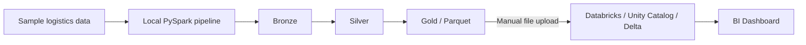
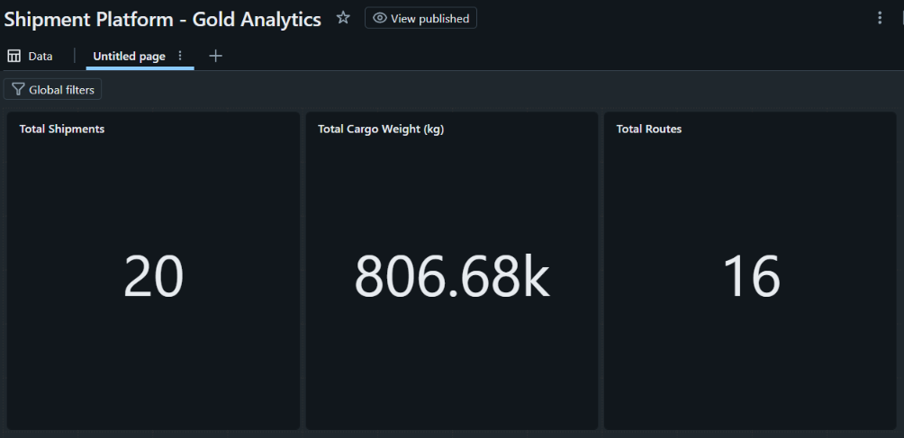

# Shipment Pulse Lakehouse

A logistics data engineering portfolio project that processes shipment data using **Apache Spark / PySpark**, organizes it into **Bronze, Silver and Gold** layers, and presents business metrics through a **Databricks AI/BI Dashboard**.

## Project overview

The goal is to demonstrate an end-to-end analytical data workflow: transforming logistics data in a local Spark environment and making the resulting Gold-layer data available for reporting.

The core pipeline runs **locally with Docker and Docker Compose**. The reporting step uses **Databricks Free Edition**, where selected Gold results were **manually imported from Parquet files** into managed Delta tables.

## Architecture



- **Bronze:** initial ingestion and preservation of source data.
- **Silver:** cleaned and transformed datasets prepared for analysis.
- **Gold:** analytical summaries of shipments and transport routes.
- **Databricks reporting:** a snapshot of Gold data imported into Unity Catalog and displayed in a published BI dashboard.

> **Integration note:** The Databricks dashboard is **not directly connected to the local pipeline**. Re-running local Spark transformations does **not** automatically refresh the Databricks tables. Updating the dashboard data requires another import or an integration step, which is not implemented here.

## Technology stack

| Area | Tools |
| --- | --- |
| Data engineering | Apache Spark 4.1.3, PySpark, Python, SQL |
| Local environment | Docker, Docker Compose |
| Local analytical data | Parquet, Spark SQL / Hive Metastore |
| Cloud reporting | Databricks Free Edition, Unity Catalog, managed Delta tables, BI Dashboards |
| Version control | Git, GitHub |

## Gold analytics dashboard

The published **Shipment Platform - Gold Analytics** dashboard contains exactly three key performance indicators (KPIs):

| KPI | Metric definition | Example result |
| --- | --- | ---: |
| Total Shipments | Count of distinct `shipment_id` values | **20** |
| Total Cargo Weight (kg) | Sum of `cargo_weight_kg`, rounded to 2 decimals | **806,678.67 kg** |
| Total Routes | Count of distinct `(origin_port, destination_port)` pairs | **16** |



**Databricks tables:**

- `shipment_platform.gold.shipment_summary`
- `shipment_platform.gold.route_summary`

The dashboard is built on Gold-layer data manually imported
from the local PySpark pipeline into Databricks.
The three SQL queries used to calculate the KPIs are available
in [`sql/databricks_dashboard_kpis.sql`](sql/databricks_dashboard_kpis.sql).

The data transfer is currently manual; automatic synchronization
between the local pipeline and Databricks is not implemented.

## Repository structure (selected files)

```text
.
├── Dockerfile                  # Local Spark image
├── docker-compose.yml          # Local runtime configuration
├── spark-pipeline.yml          # Gold pipeline configuration
├── src/                        # PySpark pipeline code
├── data/sample/                # Sample source data
├── docs/                       # Project documentations
│   └── images/databricks-gold-dashboard.png
└── sql/databricks_dashboard_kpis.sql
```

## Scope and limitations

- Processing takes place in the local Docker/Spark environment.
- Gold data is stored locally, with selected Parquet outputs imported into Databricks as managed Delta tables for reporting.
- The dashboard uses a manually uploaded data snapshot; **automated synchronization has not been implemented**.
- Power BI integration can be added separately; it is not part of the current dashboard deliverable.
